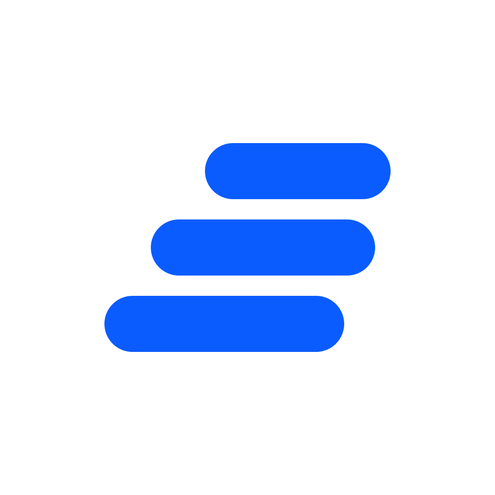
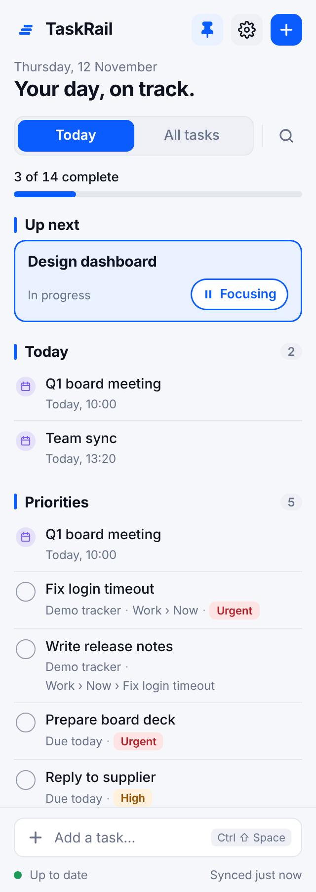
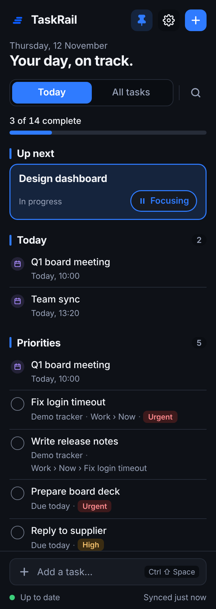

<p align="center">
  
</p>

<h1 align="center">Task Rail</h1>

<p align="center">
  A task strip that lives on the edge of your screen, fed by the systems your work already lives in.
</p>

<p align="center">
  <a href="https://github.com/markcastle/taskrail/actions/workflows/ci.yml"></a>
  <a href="https://github.com/markcastle/taskrail/actions/workflows/release.yml"></a>
  <a href="https://github.com/markcastle/taskrail/releases/latest"></a>
  <a href="LICENSE"></a>
  
  
</p>

<p align="center">
  
  &nbsp;&nbsp;
  
</p>

---

Task Rail is not another to-do list you have to remember to open. It claims a narrow column at the side of your screen, your other windows lay themselves out around it, and the next few things you should do are always in front of you. Drag a task to reprioritise it, pull it into In progress to start it, flick it away when it is done, and the change is written back to wherever the task came from. 🎯

It speaks [MCP](https://modelcontextprotocol.io), so it can read from any system that has an MCP server: your tracker, your board, your calendar. Point it at one, and it works out the rest.

> ⚠️ **Early days.** Task Rail is young and moving fast. It works, it is used daily, and it still has rough edges. Issues are very welcome.

> 🍎 **Not yet tested on a Mac.** The macOS build compiles and ships, but nobody on the project owns a Mac, so the floating panel, the menu bar icon and the installer have never been seen running. If you try it on a Mac, we would love to hear how it went, good or bad: [open an issue](https://github.com/markcastle/taskrail/issues/new) and say what you saw.

## ✨ What you get

- 📌 **Always there.** A docked strip on Windows and a floating edge panel on macOS. Hide it from the tray when you need the space back.
- 🗓️ **Your day at a glance.** Today's date, how many tasks are done, what is up next, and your priorities in the order you set.
- 🖐️ **Gestures, not menus.** Drag to reorder, pull into In progress, flick to complete, tap for details.
- 🔁 **Two-way sync.** Moving a task on the rail moves it in the system it came from.
- 🔌 **Any MCP server.** Add a server, and a model reads its tools and writes the connector for you. After that the model is out of the loop.
- 🎯 **One thing in focus.** Mark the task you are on. It sits at the top as Up next.
- ⌨️ **Quick-add anywhere.** Ctrl+Shift+Space from any window.
- 🌗 **Light, dark, or follow the system.**
- 🔐 **Your keys stay yours.** API keys and sign-in tokens live in your operating system's credential store, never in a file.

## 🚀 Install

One line. It fetches the latest release, installs for your user with no admin prompt, and starts the app. Run the same line again to update.

**Windows**, in PowerShell:

```powershell
irm https://raw.githubusercontent.com/markcastle/taskrail/main/install.ps1 | iex
```

**macOS**, in Terminal:

```bash
curl -fsSL https://raw.githubusercontent.com/markcastle/taskrail/main/install.sh | sh
```

Prefer a download? The installers are on the [releases page](https://github.com/markcastle/taskrail/releases/latest). They are not code-signed yet, so Windows and macOS will ask before the first run. The one-line install takes care of that for you.

## 🖐️ Using it

| Do this | And this happens |
| --- | --- |
| **Drag** a task up or down | It moves in the order, and that order is yours: syncing never touches it |
| **Drag** a task into In progress | It starts, and its status changes in the source system |
| **Flick** a task sideways | It completes |
| **Tap** the circle | Same thing, for people who like circles |
| **Tap** a task | Details open: source link, due date, priority, and buttons for everything else |
| **Start focus** on the Up next card | That task becomes the one you are on |
| **Ctrl+Shift+Space** | Quick-add, from anywhere on the desktop |
| **Today / All tasks** | Today keeps the fold; All tasks shows everything. The 🔍 searches both |
| **⚙️** | Settings open inside the rail: edge, width, theme, monitor, connectors, model, and the log |

The tray icon has **Show**, **Hide**, **Settings** and **Quit**. Always quit from there rather than killing the process: on Windows the reserved strip is only given back when the app exits cleanly.

## 🔌 Connect your work

Open ⚙️ and look at **Connectors**.

- **Add demo tracker** gives you a small fake issue tracker to play with. Its tickets appear in seconds. Drag one into In progress and watch the tracker move it too.
- **Add server** is the real thing. Name it, give it a URL, press **Discover**. If the server wants you to sign in, your browser opens and discovery carries on when you are back. You see what it found before you keep it.

Discovery uses a language model once, at setup, with your own key for Anthropic, OpenRouter or OpenAI. Everything after that is plain code.

Want the details, or to write a connector by hand? See [docs/connectors.md](docs/connectors.md). 📖

### 🔑 About that API key

We know. Pasting an API key into an app you found on GitHub is a lot to ask, and we want to stop asking. Until then, here is exactly what happens with it: it goes into your operating system's credential store, never into a file; it is sent only to the provider you chose, only during discovery, and never again once a connector is saved; and the code that does it is in `crates/llm`, short enough to read over coffee. Discovery is the only thing in the app that talks to a model.

The plan for not needing a key at all is on the [roadmap](docs/roadmap.md#discovery-without-an-api-key): ready-made profiles for the common systems, discovery by plain rules for servers with obvious tool names, and letting the agent you already trust do the thinking.

## 🗺️ Where it is going

Next up: an auto-updater, pausing a connector, richer task details, and animation and sound that make every gesture feel acknowledged. The full list, with what is done and what is still a question, is the [roadmap](docs/roadmap.md). The thinking behind the decisions so far is in [docs/plan.md](docs/plan.md).

## 🛠️ Developing

```bash
npm install
```

```bash
npm run dev
```

That is enough to run it from source with hot reload. Prerequisites, tests, the code layout, how releases are cut, and where the logs live are in [docs/developing.md](docs/developing.md). The shape of the code and why it is that way is in [docs/architecture.md](docs/architecture.md).

## 🤝 Contributing

Issues and pull requests are welcome, from a typo to a connector. Keep pull requests small, add a test in `crates/core` for any change in behaviour, and run `cargo fmt` and `cargo clippy --workspace --all-targets` before pushing. CI runs on Windows, macOS and Linux and will tell you if anything slipped.

If you connect Task Rail to a system and it does something odd, open an issue with the log from ⚙️ → **Logs**. That is nearly always enough to fix it.

## 📄 Licence

[MIT](LICENSE). Use it, fork it, ship it.
